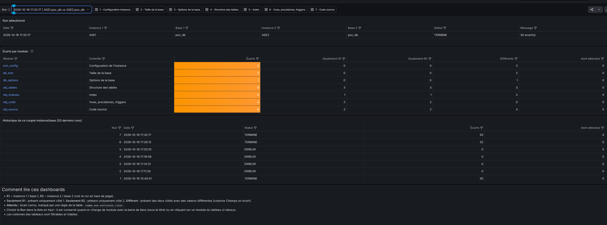

# comparaison_ase

Compare deux couples **instance / base de données** SAP ASE 16.0 et montre les écarts dans Grafana.

Pour chaque comparaison, un script extrait la configuration, la taille, les options, les tables, les index
et le code (procédures, vues, triggers) des deux côtés. Un programme Python compare les extractions et
enregistre les différences dans PostgreSQL. Grafana les affiche : une synthèse, puis un dashboard par module,
avec le détail ligne à ligne du code source.

> **Statut : POC, version 0.1** ([`CHANGELOG.md`](CHANGELOG.md)). Validé de bout en bout sur deux serveurs
> ASE 16.0 SP03 PL10 (Rocky Linux 8.10). Non testé en dehors de ce cadre : lis le code et les limites connues
> avant de l'utiliser sur des bases importantes.



## Comment ça marche

```
 ASE 1 ──┐                                                     ┌── Grafana
         ├── isql ──> CSV ──> compare.py ──> PostgreSQL ──────┤   (synthèse + 7 dashboards)
 ASE 2 ──┘   (bash/compare_ase.sh)        (schéma compa_ase)   └── historique des runs
```

- **Extraction** (`bash/`) : `isql` exécute les requêtes de `bash/queries/` sur chaque instance. Le mot de passe ASE est transmis par l'entrée standard, jamais en argument.
- **Comparaison** (`python/compare.py`) : bibliothèque standard Python 3.6+ uniquement (RHEL 8 : le `python3` par défaut suffit), enregistrement via `psql`. Écarts typés `ONLY_R1`, `ONLY_R2` ou `DIFF`, avec règles d'exclusion pour le bruit connu.
- **Stockage** (`sql/postgres/`) : schéma `compa_ase`, un historique de tous les runs.
- **Affichage** (`grafana/`) : 8 dashboards générés et provisionnés, navigation entre modules.

## Prérequis

| Élément | Version |
|---|---|
| SAP ASE | 16.0 (testé : SP03 PL10) |
| Client `isql` (Open Client) | Sur la machine qui lance le script |
| PostgreSQL | Testé avec la version 16 |
| Python | 3.6 ou plus (le `python3` de RHEL 8 convient), sans dépendance pip |
| `psql` | Client PostgreSQL |
| Grafana OSS | Version récente (testé en octobre 2026) |

Un environnement de test complet (4 VM Hyper-V créées automatiquement, deux ASE d'essai avec des écarts
connus) est décrit dans [`docs/installation_vm.md`](docs/installation_vm.md).

## Modules comparés

`inst_config`, `db_size`, `db_options`, `obj_tables`, `obj_indexes`, `obj_code`, `obj_source`

## Contenu du dépôt

| Dossier | Contenu |
|---|---|
| `bash/` | `compare_ase.sh` (orchestration), `queries/*.sql` (requêtes d'extraction), `tests/` (faux `isql`, tests). `Compare_instance_V3.sh` : ancien script, conservé pour référence |
| `docs/` | Cahier des charges du POC |
| `python/` | `compare.py` (comparaison des CSV et insertion dans PostgreSQL) et `tests/` (tests automatisés, CSV factices) |
| `sql/postgres/` | `create_schema.sql` : schéma PostgreSQL `compa_ase` (références, runs, configuration, exclusions, 7 tables `diff_<module>`, vues Grafana) |
| `sql/ase_test/` | Deux scripts créant la base `poc_db` avec des écarts volontaires (instance 1 et instance 2) |
| `infra/hyperv/` | `create_vms.ps1` + `templates/` : réseau et 4 VM Hyper-V, OS installés automatiquement. Guide : `docs/installation_vm.md` |
| `grafana/` | 8 dashboards JSON (synthèse + 7 modules, navigation par barre de liens), générateur, provisioning, tests. Voir `grafana/README.md` |
| `Deploy/` | **Les 4 archives de déploiement** (`compa_ase_depot`, `compa_ase_comparateur`, `compa_ase_grafana`, `compa_ase_serveurs_ase_test`) et leurs empreintes |
| `packaging/` | `build_packages.sh` : construit les archives de `Deploy/` ; `test_packages.sh` ; modèles des LISEZMOI (voir `docs/deploiement_archives.md`) |

## Le dossier Deploy : archives de déploiement

`Deploy/` contient **les fichiers à copier sur les machines**, prêts à l'emploi : une archive par fonction. On n'a plus besoin de cloner le dépôt sur les VM.

| Archive | À installer sur | Rôle | Ordre |
|---|---|---|---|
| `compa_ase_depot.tgz` | la machine PostgreSQL (`pg01`) | PostgreSQL, base `compa`, schéma `compa_ase`, rôle Grafana lecture seule ; `declarer-instance.sh` déclare les instances ASE à comparer | 1 |
| `compa_ase_serveurs_ase_test.tgz` | `ase01` puis `ase02` (POC uniquement) | serveur SAP ASE 16.0 (`build_server.sh`, contournement CR 824104) et base `poc_db` avec écarts voulus : 30 écarts attendus. **Les binaires SAP ASE ne sont pas fournis** | 2 (option) |
| `compa_ase_comparateur.tgz` | la machine qui lance les comparaisons (`bastion`) | `compare_ase.sh`, 7 requêtes, `compare.py`, commande `compa_ase`, comparaison quotidienne planifiée (systemd ou cron). **`isql` (SAP Open Client) doit déjà être installé** | 3 |
| `compa_ase_grafana.tgz` | `bastion` ou une autre machine | Grafana, source de données, 8 dashboards | 4 |

Chaque archive contient, à l'intérieur de son dossier :

- `LISEZMOI.md` : composants à installer, SQL à exécuter, planification (systemd et cron), vérification, mise à jour, désinstallation, dépannage ;
- `install.sh` et `verify.sh` : installation (rejouable) et contrôles ;
- `scripts/compa_ase.env.example` : paramètres à copier en `compa_ase.env` (IP, mots de passe) ;
- `SHA256SUMS` et `VERSION` : contrôle d'intégrité, version.

Pas de `manifeste.txt` Python : `compare.py` n'utilise que la bibliothèque standard (aucun paquet pip). `Deploy/SHA256SUMS` donne les empreintes des archives.

**Utilisation, sur chaque machine** (dans l'ordre du tableau) :

```powershell
# depuis Windows, après git pull
scp Deploy\compa_ase_depot.tgz admin01@192.168.50.11:~/
```

```bash
tar xzf compa_ase_depot.tgz && cd compa_ase_depot
sha256sum -c SHA256SUMS --quiet                    # contrôle d'intégrité
cp scripts/compa_ase.env.example scripts/compa_ase.env && nano scripts/compa_ase.env
sudo ./install.sh
sudo ./verify.sh
```

Les mots de passe de `compa_app` et de `grafana_ro` doivent être **identiques** dans les archives qui les partagent. Ensuite : `compa_ase -S ASE1 -D poc_db -s ASE2 -d poc_db -k`.

**Régénérer les archives** (après une modification du code, des requêtes ou des dashboards) : `packaging/build_packages.sh v0.2`, puis commiter `Deploy/`. Les fichiers de `Deploy/` sont générés : ne pas les modifier à la main. Détails et tests : [`docs/deploiement_archives.md`](docs/deploiement_archives.md).

> Statut : écrit le 2026-10-18, **à valider sur des VM neuves**. Testé en local : installation réelle du dépôt, du comparateur et de Grafana (simulé), puis comparaison avec le faux `isql` (30 écarts). Non testé : l'archive `serveurs_ase_test` (pas d'ASE disponible), `apt`/`dnf`, systemd, un Grafana réel.

## Lancer une comparaison

Prérequis sur le bastion : `psql`, `isql` (client Open Client, instances résolues par le fichier `interfaces`), Python 3.6+ (`COMPA_PYTHON` pour en choisir un autre).

1. Déclarer les deux instances ASE (un login par instance) :

```sql
INSERT INTO compa_ase.config_compa_ase (instance, host, port, login, password)
VALUES ('ASE1', 'ase01', 5000, '<login>', '<mot_de_passe>'),
       ('ASE2', 'ase02', 5000, '<login>', '<mot_de_passe>');
```

2. Lancer le script (mot de passe PostgreSQL par `PGPASSWORD` ou `~/.pgpass`) :

```
bash/compare_ase.sh -S ASE1 -D poc_db -s ASE2 -d poc_db -U <login_pg> -H <hote_pg> -p 5432 -n compa
```

| Option | Rôle |
|---|---|
| `-S` `-D` | Instance et base 1 |
| `-s` `-d` | Instance et base 2 |
| `-U` `-P` | Login et mot de passe PostgreSQL (`-P` est visible dans `ps`, préférer `PGPASSWORD`) |
| `-H` `-p` `-n` | Hôte, port et base PostgreSQL |
| `-k` | Conserver les CSV du run |

Le script vérifie le schéma PostgreSQL, lit les logins ASE dans `config_compa_ase`, crée ou retrouve le `refid`, ouvre un `run_id`, extrait les 7 modules des deux côtés, puis appelle `python/compare.py`. Le mot de passe ASE est transmis à `isql` par l'entrée standard, jamais en argument.

Les requêtes d'extraction sont dans `bash/queries/<module>.sql` : ce sont les requêtes validées en production (script client), sauf `obj_indexes` (liste des colonnes par `index_col`, à valider sur ASE). Seules les colonnes décrites dans `docs/format_csv.md` comptent.

| Code retour | Signification |
|---|---|
| 0 | Comparaison terminée |
| 1 | Arguments invalides |
| 2 | CSV invalide (retour de `compare.py`) |
| 3 | Erreur PostgreSQL (retour de `compare.py`) |
| 10 | Outil manquant ou PostgreSQL injoignable |
| 11 | Schéma ou tables PostgreSQL absents : exécuter `sql/postgres/create_schema.sql` |
| 12 | Instance absente de `config_compa_ase` |
| 13 | Connexion ou extraction ASE en échec |

## Tester sans instance ASE

Un faux `isql` (`bash/tests/fake_bin/isql`), alimenté par les CSV factices, simule le comportement d'`isql` (invite `Password:`, colonnes remplies d'espaces, code retour 0 même en cas d'échec) :

```
export COMPA_TEST_DB=compa PGHOST=<hote> PGPORT=5432 PGUSER=<login>   # base où create_schema.sql a été exécuté
bash/tests/test_compare_ase.sh
```

## Tester `compare.py` seul

```
cd python
python3 compare.py --csv-dir tests/fixtures --dry-run -v      # 30 écarts attendus
python3 -m unittest discover -s tests -v                      # tests automatisés
```

Les CSV de `tests/fixtures` reproduisent les écarts des scripts `sql/ase_test`. Les tests d'intégration PostgreSQL sont activés avec `COMPA_TEST_PG=1` (voir l'en-tête de `python/tests/test_compare.py`).

## Grafana

Installation, provisioning et navigation entre modules : [`grafana/README.md`](grafana/README.md). Tests : `COMPA_TEST_PG=1 COMPA_TEST_DB=compa python3 grafana/tests/test_dashboards.py` (exécute chaque requête de panneau sur PostgreSQL avec les 30 écarts de test).

Version 0.1 : [`CHANGELOG.md`](CHANGELOG.md). Captures des dashboards : [`images/R0.1/`](images/R0.1/) (fixtures) et [`images/R0.1/ase_reel/`](images/R0.1/ase_reel/) (run sur deux ASE réels, 30 écarts).

## Création du schéma PostgreSQL

```
createdb -h <hote> -U <login> compa
psql -h <hote> -U <login> -d compa -f sql/postgres/create_schema.sql
psql -h <hote> -U <login> -d compa -c "ALTER ROLE grafana_ro LOGIN PASSWORD '<a_definir>'"
```

Le script est rejouable sans perte de données. Le rôle `grafana_ro` (lecture seule) est créé sans mot de passe : à définir manuellement, sans le versionner.

## Documentation

- [`docs/cahier_des_charges_POC.md`](docs/cahier_des_charges_POC.md) : cahier des charges du POC
- [`docs/installation_vm.md`](docs/installation_vm.md) : création des VM Hyper-V
- [`docs/premiere_execution.md`](docs/premiere_execution.md) : liste de contrôle avant une première exécution sur un nouvel environnement
- [`docs/deploiement_archives.md`](docs/deploiement_archives.md) : déploiement par archives (`Deploy/`)
- [`docs/format_csv.md`](docs/format_csv.md) : format des CSV produits par le script bash et lus par `compare.py`

## Sécurité

Aucun mot de passe ni fichier de configuration sensible ne doit être versionné.
Les logins ASE sont lus dans la table PostgreSQL `config_compa_ase`.

## Licence

[MIT](LICENSE). Le logiciel est fourni sans garantie : teste-le sur des bases de test avant tout usage ailleurs.

## Marques et logiciels tiers

Projet indépendant, non affilié à SAP SE. SAP, Sybase et Adaptive Server Enterprise sont des marques de SAP SE.
Ce dépôt ne contient **aucun logiciel SAP** : l'installation d'ASE (édition Express ou licence) est à ta charge et
soumise à ses propres conditions. Il n'embarque pas non plus PostgreSQL, Grafana ni les systèmes d'exploitation
mentionnés dans les guides, qui ont chacun leur licence. Seuls des fichiers de configuration, des requêtes et du
code écrits pour ce projet sont publiés.

